# hybrid-rag-eval 执行流程总览

> 面向中文年报问答的本地混合检索 RAG + 三阶段对比评估。
> 本文按「离线建库 → 在线问答 → 离线评估」三条主线展开，参数均取自 `app/config.py`（当前实际值）。

---

## 0. 全局视角

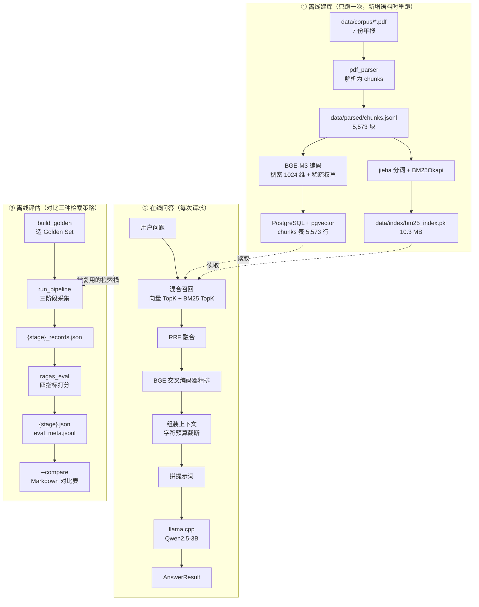

---

## 1. 阶段一：PDF 解析（`app/ingestion/pdf_parser.py`）

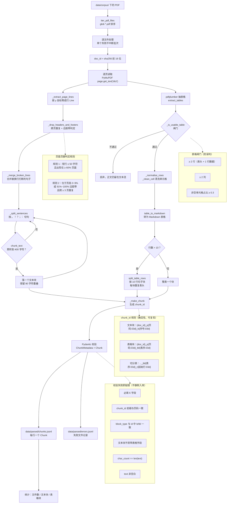

**关键参数**

| 参数 | 值 | 含义 |
|---|---|---|
| `CHUNK_SIZE` | 400 | 文本块目标字符数 |
| `CHUNK_OVERLAP` | 80 | 相邻块重叠字符数 |
| `HEADER_FOOTER_MAX_CHARS` | 50 | 判为页眉页脚的最大长度 |
| `HEADER_FOOTER_PAGE_RATIO` | 0.6 | 跨页重复比例阈值 |
| `HEADER_FOOTER_MARGIN_TOP/BOTTOM` | 0.09 / 0.91 | 边距带范围（页高比例） |
| `TABLE_SPLIT_ROWS` | 10 | 大表切分粒度 |
| `TABLE_MIN_ROWS/COLUMNS/FILL` | 2 / 2 / 0.3 | 表格闸门 |
| `TABLE_CAPTION_MAX_CHARS` | 80 | 表格标题最大长度 |
| `TABLE_CAPTION_MAX_GAP` | 40.0 | 标题与表格的最大垂直间距 |

**产物**：`data/parsed/chunks.jsonl` — 5,573 块（text 3,871 / table 1,702），7 份年报。

### 跨页表格与两级表头（解析后的两次修正）

pdfplumber 按页识别表格，于是有两类结构在切块阶段被破坏，两处都在
`pdf_parser.py` 里做了修正：

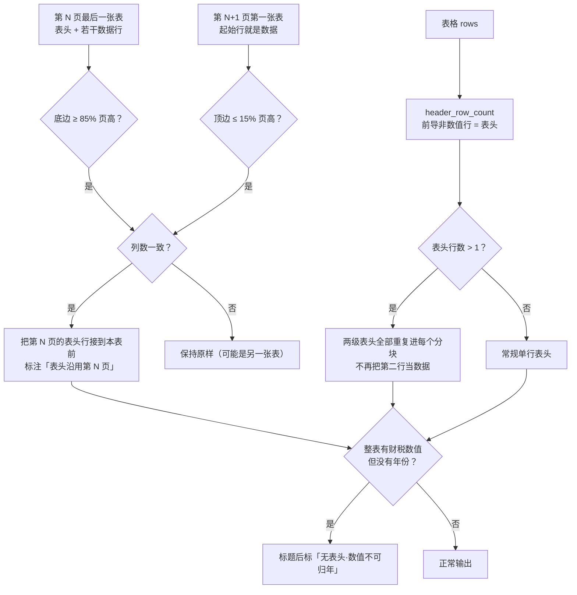

重新解析后的实际效果：

| 指标 | 修复前 | 修复后 |
|---|---|---|
| 表格块 | 1,785 | 1,702 |
| 块内无年份标记 | 861（48%） | 762（45%） |
| 跨页接回表头 | 0 | **73 个块**（40 张表） |
| 打「无表头」标记 | 0 | 34 |

第 37 页那个关键块现在是：

```text
（货币单位：人民币百万元）（续）（表头沿用第 36 页）
| 项 目 | 2024年12月31日 | | | 2023年12月31日 | | | 不良率增减 |
|  | 余额 | 占比 | 不良率 | 余额 | 占比 | 不良率 |  |
| 个人贷款（注） | 1,767,168 | 52.4% | 1.39% | 1,977,719 | 58.0% | 1.37% | +0.02个百分点 |
```

`1.39%` 属于 2024 年、`1.37%` 属于 2023 年，从块内即可读出。语料总数因此从
5,656 变为 5,573（两级表头不再计入正文），旧评估结果需要重跑。

---

## 2. 阶段二：写入向量库（`app/retrieval/vector_store.py`）

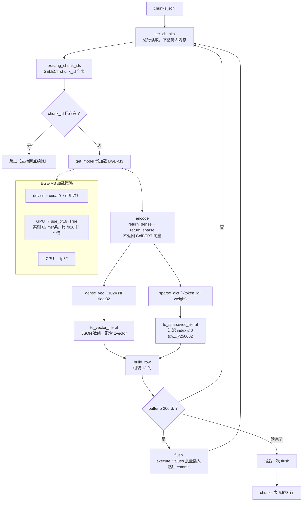

**写入的列**（`chunks` 表 13 列）

```text
chunk_id  doc_id  source  page  block_type  text  metadata(jsonb)
table_caption  table_index  row_start  row_end
dense_embedding(pgvector vector)  sparse_embedding(pgvector sparsevec)
```

**索引**

```text
chunks_pkey                    btree(chunk_id)
chunks_block_type_idx          btree(block_type)
chunks_doc_id_table_index_idx  btree(doc_id, table_index)
chunks_dense_embedding_idx     hnsw(dense_embedding vector_cosine_ops) m=16 ef_construction=64
```

> 注：当前 5,573 行的规模下查询规划器选择「全表扫描 + top-N 排序」（约 40 ms，结果精确），
> 而非 HNSW 近似索引（约 1.3 ms）。数据量增长后会自动切换。

---

## 3. 阶段三：BM25 索引（`app/retrieval/bm25_index.py`）

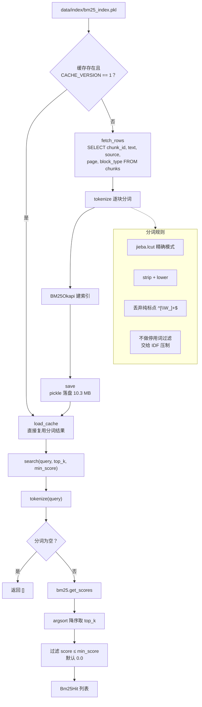

**关键点**

- 缓存含：`chunk_ids / texts / metas / tokenized corpus / CACHE_VERSION`
- 新增语料后必须 `--rebuild`，否则索引与库不一致
- 分词结果与语料 token 数：690,365（5,573 块）

---

## 4. 阶段四：在线问答链路

### 4.1 完整时序

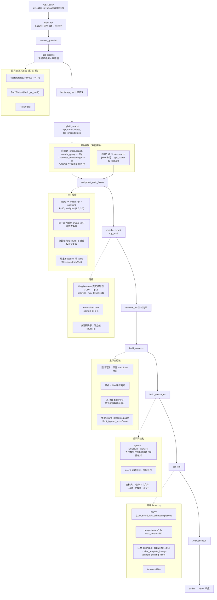

### 4.2 AnswerResult 字段

```text
question       原始问题
answer         LLM 生成的答案
contexts[]     index / chunk_id / score / text / source / page
               / block_type / rrf_score / ranks
model          使用的模型名
messages[]     实际送给 LLM 的完整消息（便于复现）
usage          prompt_tokens / completion_tokens / total_tokens
bootstrap_ms   模型加载耗时（仅首次请求非 0）
retrieval_ms   召回 + 融合 + 精排耗时
generation_ms  LLM 生成耗时
elapsed_ms     三者之和
```

### 4.3 接口与错误映射

| 路由 | 说明 | 错误 |
|---|---|---|
| `GET /` | 存活探针 → `{"message": true}` | — |
| `GET /health` | LLM 可达性 + 检索栈组件状态（不触发加载） | 返回 `reachable=false` / `ready=false` 而非报错 |
| `GET /ask?q=&top_m=&candidates=` | 完整 RAG | 参数非法 → 400 / 422；两路检索都不可用 → 503；LLM 降级且无上下文 → 503 |

约束：`q` 最小长度 1；`top_m ∈ [1,20]`；`candidates ∈ [1,100]`。

`/health` 的 `pipeline` 字段：

```json
{"loaded": {"store": true, "index": true, "reranker": true},
 "errors": {}, "ready": true}
```

> 只有「已经被请求触发加载过」的组件才反映在 `loaded` 里——健康检查本身不加载模型，
> 否则一次探活就要等几十秒。

---

## 5. 阶段五：评估（`app/eval/`）

### 5.1 三阶段对比设计

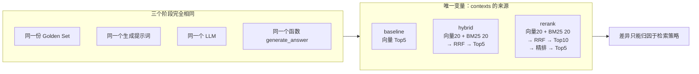

### 5.2 `build_golden.py` — 造尺子

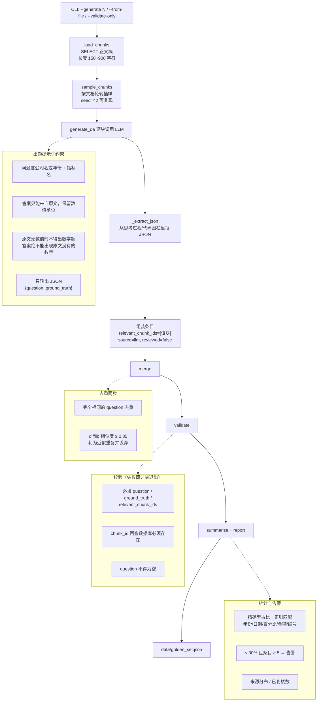

Golden Set 条目结构

```json
{
  "id": "gs_001",
  "question": "...",
  "ground_truth": "...",
  "relevant_chunk_ids": ["{doc_id}_p178_b002"],
  "source": "llm",
  "reviewed": false
}
```

### 5.3 `run_pipeline.py` — 采集原料

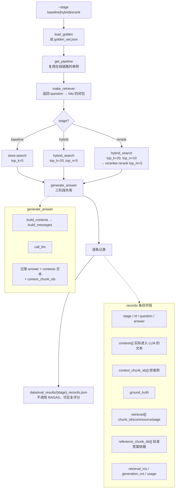

**首轮实测（23 题）**

| stage | 参考块命中 | 检索合计 | 生成合计 |
|---|---|---|---|
| baseline | 11/23 | 37.3 s | 134.9 s |
| hybrid | 19/23 | 31.4 s | 141.1 s |
| rerank | 20/23 | 251.3 s | 121.1 s |

### 5.4 `ragas_eval.py` — 打分与对比

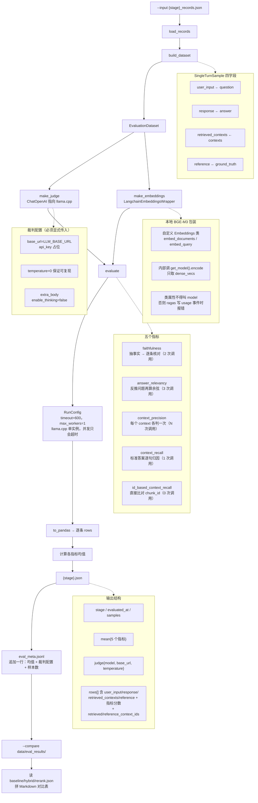

### id 召回：补上 context_recall 饱和后的区分度

`context_recall` 是让裁判读标准答案、逐句判断「能否由上下文归因」。实测它在
hybrid 与 rerank 上**恒为 1.0**（23 条全满分）：标准答案多是单句单事实，加上 3B
裁判偏「Yes」，这个指标已经没有区分力。

因此加了一个零成本指标 `id_based_context_recall`：不算语义，直接看
「Golden Set 标的参考 chunk_id，有几个真的出现在检索结果里」。

| stage | id 召回 | 等价命中数 |
|---|---|---|
| baseline | 0.4783 | 11/23 |
| hybrid | 0.7826 | 18/23 |
| rerank | **0.8696** | **20/23** |

它与手工数的「参考块命中」完全一致，并且把 hybrid 和 rerank 拉开了差距——
这正是 `context_recall` 做不到的。

两个相关开关：

```bash
# 只补算 id 召回并合并进已有结果（秒级，不重跑要裁判的指标）
python -m app.eval.ragas_eval --input ... --metrics id_based_context_recall --merge

# 只跑指定指标
python -m app.eval.ragas_eval --input ... --metrics faithfulness,context_precision
```

---

## 6. 完整执行顺序（CLI）

```powershell
cd backend

# ---------- ① 离线建库（只跑一次）----------
python -m app.ingestion.pdf_parser --input data/corpus --output data/parsed/chunks.jsonl
python -m app.retrieval.vector_store --input data/parsed/chunks.jsonl --batch-size 200
python -m app.retrieval.bm25_index --rebuild

# ---------- ② 启动本地 LLM ----------
llama-server -m E:\worksapce\models\qwen2.5-3b\qwen2.5-3b-instruct-q5_k_m.gguf `
             -c 8192 -ngl 999 --port 8080 --host 0.0.0.0 -fa auto

# ---------- ③ 在线问答 ----------
python -m app.main                    # 或 uvicorn app.main:app --reload
# GET http://127.0.0.1:8000/ask?q=万科2024年的研发投入金额是多少

# 单模块自测
python -m app.retrieval.vector_store -q "研发投入" -k 5
python -m app.retrieval.bm25_index   -q "研发投入" -k 5
python -m app.retrieval.rrf          -q "研发投入"
python -m app.retrieval.reranker     -q "研发投入" -m 5
python -m app.generation.answer      -q "万科2024年的研发投入金额是多少"

# ---------- ④ 评估：造题 ----------
python -m app.eval.build_golden --generate 30      # 生成并合并
python -m app.eval.build_golden --validate-only    # 只校验
python -m app.eval.build_golden --from-file x.json # 并入人工标注

# ---------- ⑤ 评估：三阶段采集 ----------
python -m app.eval.run_pipeline --stage baseline
python -m app.eval.run_pipeline --stage hybrid
python -m app.eval.run_pipeline --stage rerank
# 调试可加 --limit 3

# ---------- ⑥ 评估：打分与对比 ----------
python -m app.eval.ragas_eval --input data/eval_results/baseline_records.json
python -m app.eval.ragas_eval --input data/eval_results/hybrid_records.json
python -m app.eval.ragas_eval --input data/eval_results/rerank_records.json
python -m app.eval.ragas_eval --compare data/eval_results/
```

---

## 7. 模块与文件对照

| 模块 | 入口 | 输入 | 输出 |
|---|---|---|---|
| `app/ingestion/pdf_parser.py` | `python -m app.ingestion.pdf_parser` | `data/corpus/*.pdf` | `chunks.jsonl` + `errors.jsonl` |
| `app/ingestion/schema.py` | （被 import） | — | `Chunk` / `ChunkMetadata` 校验模型 |
| `app/ingestion/utils.py` | （被 import） | — | 日志、sha256、路径归一 |
| `app/retrieval/vector_store.py` | `--input` / `-q` | `chunks.jsonl` 或查询 | PG 行 / `VectorHit[]` |
| `app/retrieval/bm25_index.py` | `--rebuild` / `-q` | PG rows 或查询 | `bm25_index.pkl` / `Bm25Hit[]` |
| `app/retrieval/rrf.py` | `-q` | `VectorHit[] + Bm25Hit[]` | `FusedHit[]` |
| `app/retrieval/reranker.py` | `-q -m` | `FusedHit[]` | `RerankedHit[]` |
| `app/generation/answer.py` | `-q` | 问题 | `AnswerResult` |
| `app/main.py` | `python -m app.main` | HTTP GET | JSON |
| `app/eval/build_golden.py` | `--generate` / `--validate-only` | PG + LLM | `golden_set.json` |
| `app/eval/run_pipeline.py` | `--stage` | `golden_set.json` | `{stage}_records.json` |
| `app/eval/ragas_eval.py` | `--input` / `--compare` | `{stage}_records.json` | `{stage}.json` + `eval_meta.jsonl` |
| `app/config.py` | （被 import） | 环境变量 `RAG_PG_DSN` | 全部参数 |

---

## 8. 数据流与依赖关系

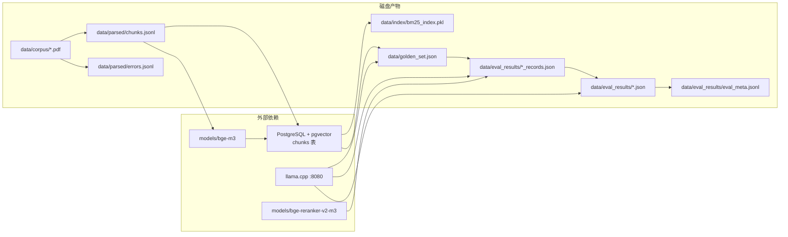

---

## 9. 已测得的性能基线

| 环节 | 实测值 | 条件 |
|---|---|---|
| PDF 解析 | 7 份 / 5,573 块 | PyMuPDF + pdfplumber |
| BGE-M3 编码 | 62 ms/条 | GPU bf16（CPU 475 ms/条） |
| 向量检索 | 42.8 ms | 5,573 行，全表扫描 + top-N（精确） |
| 向量检索（强制索引） | 1.3 ms | HNSW 近似，`enable_seqscan=off` |
| BM25 查询 | ~3 ms | 686,346 tokens |
| BM25 建索引 | 7.5 s | 5,573 块 |
| 精排 | 633 ms/条 @512 | fp16（fp32 为 736 ms） |
| 精排 | 427 ms/条 @256 | fp16，max_length 减半 |
| LLM 解码 | 34.4 tok/s | Qwen2.5-3B，`-ngl 999` |
| LLM 解码 | 19.1 tok/s | Qwen3.5-4B，`-ngl 999` |
| LLM 解码 | 4.0 tok/s | 任一模型，`-ngl 0`（CPU） |
| 首次 `/ask` | ~95 s | 加载 37 s + 检索 57 s + 生成 1.3 s |
| 后续 `/ask` | ~11 s | 检索 10 s + 生成 1 s |
| 单条 RAGAS 评分 | ~155 s | 5 指标（4 个要裁判，id 召回零调用） |

---

## 10. 首轮评估结果（23 题 × 3 阶段）

| 指标 | baseline | hybrid | rerank |
|---|---|---|---|
| faithfulness | 0.5507 | 0.5303 | **0.8043** |
| answer_relevancy | 0.6068 | 0.6726 | **0.7137** |
| context_precision | 0.5922 | 0.7873 | **0.8380** |
| context_recall | 0.8043 | 1.0000 | 1.0000 |
| id_based_context_recall | 0.4783 | 0.7826 | **0.8696** |
| 拒答数 | 5 | 3 | **1** |

rerank 全项领先；它最大的贡献是**把正确块排进前 5**——`context_precision` 从 0.79 升到 0.84、`id 召回` 从 18/23 升到 20/23，而 `context_recall` 早已饱和（恒为 1.0）。
注意 hybrid 的 faithfulness（0.5303）略低于 baseline（0.5507）。逐条看是三种不同原因，
说明这个指标对「拒答」和「答案变长」同样敏感：

| 题 | baseline | hybrid | 真实原因 |
|---|---|---|---|
| 2023 年末个人贷款不良率 | 1.37%（1.00） | **1.39%**（0.00） | 取了 2024 年的数字——正是 `answer_check` 要拦的那类错误 |
| 2021-2024 住宅物业换手率 | 1.7%→3.3%（1.00） | **拒答**（0.00） | 答案里没有可归属的陈述，直接记 0 |
| 2025 相对 2024 不良率 | 0.67 | 0.17 | 答案更长、混入两年数据，被支持的比例反而下降 |

所以看均值时要结合逐条，不要只看一个数字。

---

## 11. 已知坑与规避

| 坑 | 现象 | 规避 |
|---|---|---|
| Qwen3.5 是思考模型 | `content` 恒为空，token 全烧在 `reasoning_content` | `chat_template_kwargs={"enable_thinking": false}` |
| llama.cpp 默认不用 GPU | 解码 4 tok/s | 启动加 `-ngl 999` |
| ragas embeddings 包装 | 类属性叫 `model` 会触发 `ValidationError` | 改名 `_ensure_encoder` |
| ragas 并发 | llama.cpp 单实例，高并发全部超时 | `RunConfig(max_workers=1, timeout=600)` |
| 裁判偶发解析失败 | 该条指标为 `NaN`，均值显示 `—` | 重跑该阶段 |
| 脚本方式运行 | `ModuleNotFoundError: No module named 'app'` | 各模块顶部 `sys.path` 修补 |
| 万科文件名含全角空格 | `000002_万  科Ａ_...` 字符串匹配失败 | 比对前归一化空格与全角字母 |
| 表格页只有表头 | LLM 出的题不可作答（答案编造 `0`） | 出题提示词禁止 + 人工审阅 |
| 缓存与库不一致 | 新增语料后 BM25 搜不到 | `--rebuild` |

---

## 12. 降级策略

在线链路的四个依赖（向量库、BM25、精排模型、LLM）都可能不可用。原则是：
**能用什么就用什么，但必须让调用方看得见降级。**

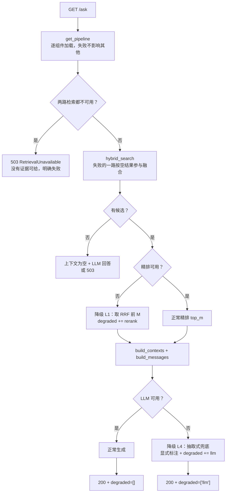

### 降级阶梯

| 级别 | 触发条件 | 行为 | 质量代价（实测） |
|---|---|---|---|
| 正常 | 全部可用 | 向量20 + BM25 20 → RRF → 精排5 → LLM | faithfulness 0.733 |
| L1 | 精排不可用（模型缺失 / 显存不足） | 取 RRF 前 5 直接送 LLM | faithfulness 0.529（−0.20） |
| L2 | 向量路不可用（PG 断连 / 模型加载失败） | BM25 单路 → RRF → 精排 | baseline 水平（0.467） |
| L3 | 向量 + 精排都不可用 | BM25 单路 → 取前 5 送 LLM | 同上，少一道精排 |
| L4 | LLM 不可用 | 返回 top1 原文，**answer 以「（本地 LLM 不可用…）」开头**，`degraded=["llm"]` | 无生成，只给证据 |
| 失败 | 两路检索都不可用 | HTTP 503 | 无证据可给，必须报错 |

### 响应契约

`AnswerResult` 新增两个字段（`asdict` 后即出现在 `/ask` 响应里）：

```json
{
  "degraded": ["rerank", "llm"],
  "warnings": ["rerank: RuntimeError: CUDA out of memory", "llm: LLMError: 连接被拒绝"]
}
```

- `degraded` 为空 → 全链路正常
- `degraded` 非空 → **`answer` 的可信度下降，客户端必须提示用户**
- 特别地 `"llm" in degraded` 表示 `answer` 是原文摘抄，不是生成的

### 自愈

失败的组件**不会被缓存成「永久不可用」**：`get_pipeline()` 只缓存成功的组件对象，
失败的组件下次调用会重新尝试加载。因此 PG 重启、显存释放后无需重启服务。

对应开关（`app/config.py`）：

| 配置 | 默认 | 作用 |
|---|---|---|
| `DEGRADE_ON_ROUTE_FAILURE` | `True` | 单路失败是否降级为单路直通 |
| `DEGRADE_ON_RERANK_FAILURE` | `True` | 精排失败是否退回 RRF 顺序 |
| `DEGRADE_ON_LLM_FAILURE` | `True` | LLM 失败是否返回抽取式兜底 |
| `FALLBACK_ANSWER_CHARS` | 300 | 兜底答案里带多少字原文 |

全部设为 `False` 即可还原成「任一环节失败就整体报错」的严格模式。

### 评估侧不降级

`run_pipeline` 的 `make_retriever` **故意不做降级**：某个 stage 缺组件时直接
`SystemExit`。否则会产出一批「降级后的 records」，把三阶段对比的前提
（只换检索策略）破坏掉。

但它对**单题失败**是容错的：某题 LLM 超时就记为 `failed: true` 继续跑，
并且每完成一条就增量落盘（`--flush-every`，默认 1），进程被杀也不丢已完成的部分。
评分时默认跳过 `failed` 的样本（`--include-failed` 可一并评估），
避免用空答案把均值拉成 0。

---

## 13. 问题追踪线索（trace）

出问题时最容易陷入的困境：只看最终上下文，猜不出「正确片段是在哪一步丢的」。
追踪线索把每个检索阶段看到的东西都记下来。

### 七个阶段

| 阶段 | 记录内容 | 回答什么问题 |
|---|---|---|
| `vector` | Top-K 的 `chunk_id` / `score` / `text[:80]` | 向量路有没有召回正确片段 |
| `bm25` | Top-K 的 `chunk_id` / `score` / `text[:80]` | 关键词路有没有召回正确片段 |
| `rrf` | 融合后有序 `chunk_id` + RRF score + **各路名次** | 融合有没有把正确片段压下去 |
| `rerank` | 精排前后各 Top-M + 精排分 + **池内名次** | 重排把片段调进还是调出了窗口 |
| `context` | 最终进 Prompt 的 `chunk_id` / 来源 / 字数 | 模型实际看到什么（唯一真相） |
| `timing` | 各阶段耗时与组件加载耗时 | 慢在加载还是慢在查询 |
| `fallback` | 降级标记与原因 | 为什么这次结果和平时不一样 |

### 数据结构

```json
{
  "query": "平安银行2023年末个人贷款不良率是多少？",
  "vector": [{"rank": 1, "chunk_id": "...", "score": 0.7156, "preview": "..."}],
  "bm25":   [{"rank": 1, "chunk_id": "...", "score": 22.99, "preview": "..."}],
  "rrf":    [{"rank": 1, "chunk_id": "...", "score": 0.0639,
              "ranks": {"vector": 8, "bm25": 1}, "preview": "..."}],
  "rerank": {
    "before": [{"rank": 1, "chunk_id": "...", "score": 0.0639, "pool_rank": 1}],
    "after":  [{"rank": 1, "chunk_id": "...", "score": 0.9989, "pool_rank": 9}]
  },
  "context": [{"index": 1, "chunk_id": "...", "source": "x.pdf", "page": 37, "chars": 393}],
  "timing": {"bootstrap_ms": 83959.5, "load_store_ms": 66472.5, "load_index_ms": 425.2,
             "load_reranker_ms": 17061.8, "vector_ms": 134.4, "bm25_ms": 26.4,
             "rrf_ms": 0.1, "rerank_ms": 16964.4, "context_ms": 0.0,
             "generation_ms": 1449.7, "total_ms": 107443.2},
  "fallback": [],
  "warnings": []
}
```

`pool_rank` 是精排阶段特有的：该片段在**融合后完整候选池**里的名次。它比「前后各 Top-M」
更有用——某条可能原本在池内第 9 名，根本不在前 M 里，却被打分提上来。

### 怎么用

```powershell
# CLI：直接打印可读的树状追踪
python -m app.generation.answer -q "平安银行2023年末个人贷款不良率是多少？" --trace

# HTTP：默认返回 trace，可关掉以减小响应体
GET /ask?q=...&trace=false

# 评估采集：每题的 record 里带 trace
python -m app.eval.run_pipeline --stage rerank --trace
```

### 一次真实追踪的读法

```text
─ vector（134.4ms） 20 条
    1.  0.715576  77d98b2636f31c0a_p055_b003   2024年末，本行个人贷款不良率较三季末…
                        ← 正确片段 _p037_b002 根本不在向量 Top20 里
─ bm25（26.4ms） 20 条
    3. 19.715890  8561144288e31ff5_p037_b002   2023 年，国内经济整体回稳…1.37%
                        ← BM25 找到了它（第 3 名）
─ rrf（0.1ms） 20 条
    9.  0.047619  8561144288e31ff5_p037_b002  (bm25=3)
                        ← 融合后掉到第 9，落在 Top5 窗口外
─ rerank（16964ms） 前 3 → 后 3
   后 #1  8561144288e31ff5_p037_b002  rerank=0.9989（池内 #9 → 精排 #1，+8 位）
                        ← 精排把它从第 9 拉回第 1，是唯一救了它的一步
─ context 3 条
   [1] 8561144288e31ff5_p037_b002  000001_平安银行_2023年年度报告.pdf 第37页
```

结论一眼可见：**向量路漏召回、BM25 命中、RRF 稀释到窗口外、精排救回**。
没有追踪时，这个结论要手工比对三个文件才能拼出来。

### 两条实测注意事项

**1. 首次调用含 CUDA 预热，不代表稳态。** 同一进程里第一次 `vector_ms` 约 4.3 s，
后续中位数 **134 ms**；`bm25_ms` 首次 737 ms，后续 26 ms。看稳态要取中位数。

**2. 精排是检索侧真正的瓶颈，且与显存争用无关。** 实测 20 条候选（每条约 390 字）：

| 环境 | 精排 20→Top5 |
|---|---|
| llama.cpp 占用显存 | 14 945 ms |
| llama.cpp 已停止 | 14 614 ms |

两者几乎相同，说明**不是 4 GB 显存不够导致的**，而是交叉编码器本身的成本：
约 730 ms/条，按 `RERANK_MAX_LENGTH=512` 计算。想提速就把 `RERANK_MAX_LENGTH`
降到 256（实测约 427 ms/条）或减少 `RERANK_CANDIDATES`。
